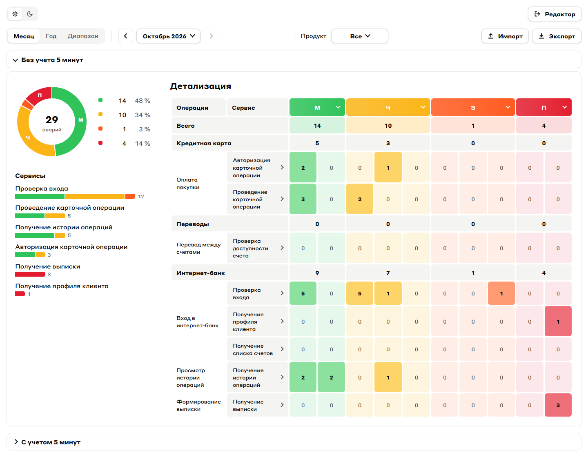
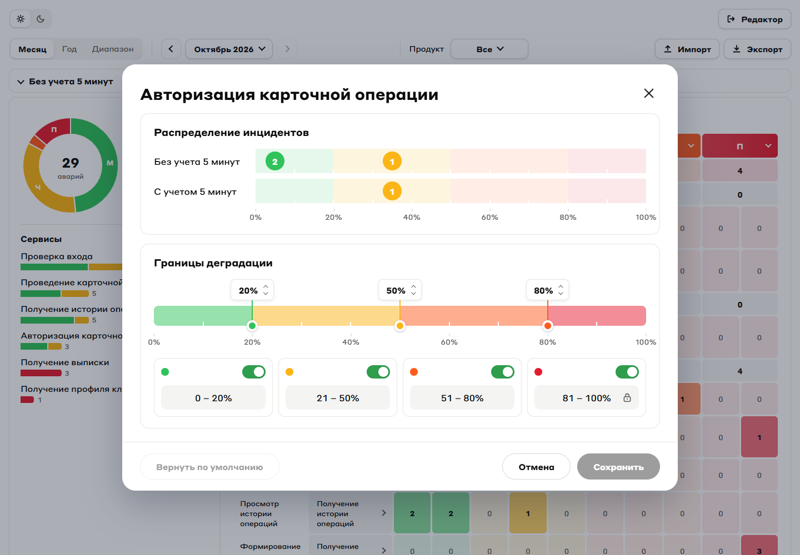
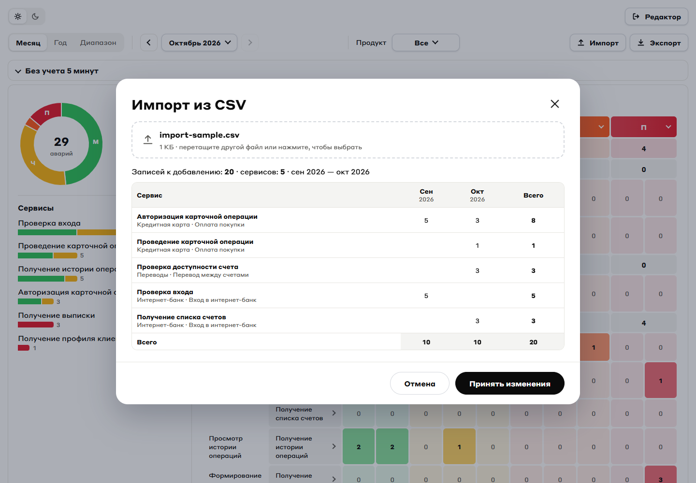
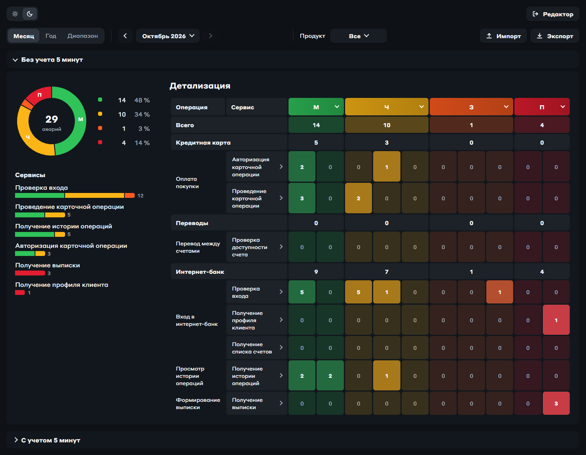

# Деградация сервисов

Дашборд, который показывает, как часто и насколько сильно деградировали сервисы за выбранный период. Внутри PostgreSQL 18, бэкенд на FastAPI, фронт на React + Vite (SCSS), вход через Keycloak. Всё поднимается одной командой в Docker.



## Запуск

Без `.env` compose не стартует: там пароли и адрес дашборда. Для локального запуска хватит шаблона:

```sh
cp .env.example .env
docker compose up -d --build
```

Keycloak поднимается секунд 20–30, фронт его ждёт. Потом открываем:

- дашборд: http://localhost:8000, логины `reader` / `reader` и `editor` / `editor` (пароли из `.env`);
- Swagger: http://localhost:8000/api/docs;
- админка Keycloak: http://localhost:8000/auth/admin/, логин и пароль из `KC_ADMIN_*`;
- Postgres: localhost:5432.

Если порты заняты:

```sh
DB_HOST_PORT=55432 WEB_HOST_PORT=8001 docker compose up -d
```

Вход и проверка токенов завязаны на адрес дашборда. При смене `WEB_HOST_PORT` он пересчитается сам. Если дашборд открывают не с `localhost`, нужно прописать `PUBLIC_URL` в `.env`.

Код попадает в образ при сборке, так что после правок сервис надо пересобрать:

```sh
docker compose up -d --build backend
docker compose up -d --build frontend
```

Фронт удобнее править через dev-сервер Vite (Node 22+). Он запустится на http://localhost:5173 и будет ходить за `/api` и `/auth` в запущенные контейнеры:

```sh
cd frontend
npm install
npm run dev
```

## Что есть на странице

Сверху выбирается период: месяц, год или произвольный диапазон дат, плюс фильтр по продукту. По умолчанию открыт последний месяц, за который есть данные. Бэкенду всегда уходят две даты, месяц и год превращаются в них на фронте (`frontend/src/period.js`).

Дальше два блока, по одному на метрику: «Без учета 5 минут» и «С учетом 5 минут». В каждом кольцо по степеням, полосы по сервисам и таблица «как в Excel». Колонки таблицы — диапазоны по 10%, строки — продукты, операции и сервисы. Клик по степени в шапке таблицы, по сектору кольца или строке легенды подсвечивает эту степень.

### Степени деградации

Диапазоны собираются в четыре степени, названия взяты из МУ:

| Степень | По умолчанию |
|---|---|
| минимальная | 0–20% |
| частичная | 21–50% |
| значительная | 51–80% |
| полная | 81–100% |

Границы по умолчанию лежат в `STEPEN_BOUNDS` (`frontend/src/config.js`).

У отдельного сервиса границы можно поменять: клик по сервису в таблице открывает окно со шкалой. Лишнюю степень можно выключить, тогда её диапазон отходит соседней. Сервисы со своими границами в таблице обведены рамкой. Всё это хранится только на странице (`serviceBounds` в `App.jsx`): на сервер не уходит и после перезагрузки сбрасывается.



### Экспорт в Excel

«Экспорт» скачивает `.xlsx` за выбранный период и продукт. В файле три листа:

- «Без изменений»: у всех сервисов границы по умолчанию;
- «С изменениями»: как сейчас на странице, сверху таблица изменённых границ;
- «Сырые данные»: случаи по одному, колонки `id`, `case_date`, `product`, `operation`, `service`, `metric`, `bucket`. У шапки есть фильтры, она закреплена и повторяется при печати.

На первых двух листах для обеих метрик есть сводка по степеням, список сервисов и детализация с той же раскраской, что на странице. У ненулевых ячеек сервисов в детализации есть подсказка: при наведении видно, из каких случаев сложилось число, по строке на случай (`#1042 · 07.10.2026`). Это обычные примечания Excel, а не новые цепочки комментариев, поэтому они работают и в старых версиях. У строк «Всего» и продуктов подсказок нет: в них сотни случаев, для этого есть «Сырые данные».

Случаи по одному страница запрашивает только при нажатии «Экспорт» (`GET /api/cases`). Перед сборкой она сверяет их с числами на странице. Если с момента загрузки страницы в базе что-то поменялось, например кто-то сделал импорт, файл не собирается, и появляется просьба обновить страницу. Иначе подсказки разошлись бы с числами в ячейках.

Файл собирается прямо в браузере через [ExcelJS](https://github.com/exceljs/exceljs) (`frontend/src/excel.js`). Библиотека весит около 250 КБ в gzip, поэтому подгружается только по нажатию кнопки. Окно примечания ExcelJS пишет постоянного размера, и длинный список в нём обрезался бы. Поэтому готовый файл дорабатывается через [JSZip](https://stuk.github.io/jszip/): у примечаний включается автоматический размер. Excel всегда в светлых цветах, даже если на странице тёмная тема.

### Импорт из CSV

«Импорт» добавляет случаи деградации из CSV. Кнопка работает только у роли `editor`, у `reader` она серая, а при наведении появляется подсказка про права.

Формат как у `db/seed/degradation_case.csv`: колонки `service_id,metric_id,bucket_id,case_date`, дата `ГГГГ-ММ-ДД`. Разделитель `;` тоже подойдёт, Excel с русской локалью сохраняет CSV именно так. Размер файла до 1 МБ. Для пробы есть маленький `test/drop1.csv`.

Файл перетаскивают в окно или выбирают кликом. Сначала сервер его только проверяет и ничего не пишет. Окно показывает имя файла, под ним сколько в нём записей и с какой по какую дату, а рядом кнопку «Заменить файл» (другой файл можно и перетащить на эту строку). Строки с ошибками выводятся с номерами и причинами. Ниже сами записи файла по страницам: дата, сервис, метрика, диапазон. Они только для просмотра, импортируется весь файл. Файл с ошибками принять нельзя. «Импортировать N записей» записывает всё одной транзакцией от имени того, кто вошёл, после этого дашборд перезагружает данные.

Повторы никак не отсеиваются: если импортировать один файл дважды, записи добавятся дважды. Отличить повтор от настоящего второго случая в тот же день всё равно нельзя.



### Светлая и тёмная тема

Переключатель стоит слева вверху: на дашборде, на экране «Войти» и на странице входа Keycloak. Выбор запоминается в `localStorage` (ключ `theme`), а пока его нет, берётся тема системы. Keycloak открыт на том же адресе, что и дашборд, поэтому видит тот же выбор.

Цвета заданы CSS-переменными в `frontend/src/styles/global.scss`, для тёмной темы у них свои значения. Тёмные фоны ячеек степеней лежат в `config.js` (поле `dark`). Логика темы у дашборда в `src/theme.js`, у Keycloak своя копия в `keycloak/themes/degradations/login/resources/js/theme.js`.



### Иконки

Иконки взяты из дизайн-системы Admiral: пакет [`@admiral-ds/icons`](https://www.npmjs.com/package/@admiral-ds/icons), версия закреплена точно на 2.0.0. Компоненты Admiral не используются, только иконки.

В SVG Admiral зашит цвет (`#626F84`), поэтому файл иконки служит маской (CSS `mask`): от него берётся только форма, а цвет — от текста рядом. Так иконки перекрашиваются вместе с темой. В разметке иконку рисует компонент `Icon` (`src/components/Icon`), например `<Icon src={exitIcon} />`. Уголки у кнопок со списком, стрелки листания и крестик окна рисуются в стилях миксином `icon` (`src/styles/_mixins.scss`).

Солнца в версии 2.0.0 нет (оно появилось в 2.2.0), поэтому оно своё: `src/icons/sun.svg`, нарисовано так же, как иконки Admiral (сетка 24, линии 1.3). Переключатель на странице входа Keycloak держит свою копию солнца и луны в `keycloak/themes/degradations/login/resources/js/theme.js`.

## Как устроено

```
браузер -> frontend (nginx, :8000) -> статика React
                                   -> /api/*  -> backend (FastAPI) -> db (PostgreSQL)
                                   -> /auth/* -> keycloak
```

Фронт собирается внутри образа, nginx отдаёт статику и проксирует `/api/*` на бэкенд, а `/auth/*` в Keycloak. Страница, API и Keycloak живут на одном адресе, поэтому CORS не нужен, а тихая проверка входа в iframe не натыкается на блокировку сторонних cookie.

### API

```
GET  /api/data?from=2026-01-01&to=2026-03-31     reader, editor
GET  /api/cases?from=2026-10-01&to=2026-10-31    reader, editor
POST /api/cases                                  editor
POST /api/cases/import[?dry_run=true]            editor
```

`GET /api/data` отдаёт всё, что нужно дашборду за период. Без `from`/`to` отдаёт последний месяц с данными.

`GET /api/cases` отдаёт случаи за период по одному, по дате, а внутри дня по `id`. Обе даты обязательны. Нужен для экспорта в Excel:

```json
{"cases": [{"id": 494, "service_id": 4, "metric_id": 1, "bucket_id": 3, "case_date": "2026-10-01"}]}
```

`POST /api/cases` добавляет один случай. В интерфейсе его нет, он нужен, чтобы проверить роли. Операция и продукт берутся из сервиса:

```json
{"service_id": 1, "metric_id": 1, "bucket_id": 3, "case_date": "2026-10-14"}
```

Сервис должен быть действующим, дата не в будущем и не раньше 2000 года, лишние поля и строки вместо чисел не принимаются. В ответ `201` и созданная запись с `id`, `created_at` и `created_by` (имя пользователя из токена).

`POST /api/cases/import` вызывает кнопка «Импорт». Тело — текст CSV (`Content-Type: text/csv`). С `?dry_run=true` сервер только проверяет файл и возвращает годные строки (`records`), названия их сервисов и ошибки. Без него проверяет ещё раз и пишет всё одной транзакцией: `201 {"added": 20}`. Если хоть одна строка с ошибкой, не пишется ничего. Правила для строк те же, что у `POST /api/cases`.

Ошибки приходят как `{"error": "..."}`:

| Код | Когда |
|---|---|
| 400 | неправильные даты или данные |
| 401 | нет токена или он плохой |
| 403 | не хватает роли |
| 404 | случаев в базе нет или нет такого адреса |
| 409 | сервис убрали в архив прямо во время импорта |
| 413 | файл больше 1 МБ |
| 422 | тело запроса не по форме |
| 500 | ошибка базы |

## Вход и роли

Вход по OpenID Connect: Authorization Code Flow с PKCE (S256). Клиент `dashboard` в realm `degradations` публичный, без секрета. Вход по логину и паролю напрямую через API (password grant) выключен.

Порядок такой. При открытии страница тихо спрашивает Keycloak, есть ли уже вход (`frontend/src/auth.js`, библиотека `keycloak-js`). Если нет, показывает экран «Войти». Кнопка ведёт на страницу Keycloak, после входа браузер возвращается на дашборд с кодом, и `keycloak-js` меняет его на токены. Каждый запрос к API идёт с `Authorization: Bearer <access token>`. Токен живёт 5 минут, и если ему осталось меньше 30 секунд, перед запросом он обновляется. Бэкенд (`backend/app/auth.py`) проверяет подпись RS256 по ключам Keycloak, `iss`, `aud` (`dashboard-api`) и срок, а роли берёт из `realm_access.roles`.

Роли и тестовые пользователи описаны в `keycloak/realm-degradations.json`:

| Пользователь | Роль | Что может |
|---|---|---|
| `reader` | `reader` | смотреть дашборд, выгружать Excel |
| `editor` | `editor` | всё то же плюс импорт CSV и `POST /api/cases` |

Пароли подставляются при импорте realm из `KC_READER_PASSWORD` и `KC_EDITOR_PASSWORD`. Пользователь без роли войти сможет, но API ответит 403, и на странице будет ошибка и кнопка выхода. Серая кнопка «Импорт» у reader только для удобства, настоящие права проверяет бэкенд.

Keycloak работает в режиме `start-dev` со своей встроенной базой. Realm импортируется из `realm-degradations.json` при создании контейнера, поэтому правки в админке живут только до его пересоздания. Если что-то нужно сохранить, это надо вносить в json.

Страница входа Keycloak оформлена под дашборд. Тема `degradations` (`keycloak/themes/degradations/login`) берёт разметку у стандартной темы `keycloak`, а стили у неё полностью свои: `resources/css/degradations.css`. Шрифт берётся с фронта из `/fonts/`. В `start-dev` темы не кэшируются, так что правки видны после обновления страницы.

## Данные

Главный источник данных — PostgreSQL. CSV из `db/seed/` нужны только для первого наполнения.

Схема и загрузка CSV лежат в `db/init.sql`. Postgres выполняет его сам и только один раз: при первом старте на пустом томе. Ни рестарт, ни пересборка его не запускают, поэтому правки CSV или схемы в уже созданную базу не попадут. Чтобы залить всё заново, базу придётся пересоздать. Это сотрёт всё, что добавили через API и импорт:

```sh
docker compose down -v && docker compose up -d
```

Если поменялась схема в `init.sql`, а база старая, бэкенд начнёт падать с 500 на запросах к новым столбцам. Тогда либо пересоздать базу, либо внести правку руками через `ALTER TABLE`.

Иерархия такая: продукт → операция → сервис. Случай деградации (`degradation_case`) ссылается только на сервис, операция и продукт выводятся из него. У случая есть дата, метрика и диапазон (`bucket_id`). Точный процент не хранится, только диапазон с шагом 10%: 0–10, 11–20, …, 91–100 (таблица `bucket`). По этим же диапазонам строятся колонки таблицы на дашборде.

У каждого случая свой номер `id` (`bigint GENERATED ALWAYS AS IDENTITY`), его выдаёт только база. Уникальности по сервису, метрике, диапазону и дате нет намеренно: два одинаковых случая в один день остаются двумя случаями с разными `id`. В seed таких пар 16. В базе, созданной до перехода на `bigint`, `id` был `int`. Перевести её можно без пересоздания, identity-последовательность сменит тип вместе со столбцом:

```sh
docker compose exec db psql -U postgres_admin -d testdb -c "ALTER TABLE degradation_case ALTER COLUMN id TYPE bigint"
```

Продукты, операции и сервисы — обычные справочники в базе, в коде их названий нет. Чтобы добавить сервис, достаточно строки в `service`. Он сразу появится на дашборде, и на него можно будет заводить случаи:

```sql
INSERT INTO service (operation_id, name, created_by) VALUES (2, 'Проверка лимитов', 'admin');
```

Сервис, у которого есть случаи, удалить не даст внешний ключ. Вместо удаления его убирают в архив (`is_active = false`): новые случаи на него API не примет, а история останется на дашборде.

Немного задела под будущие POST / PATCH / DELETE уже есть:

- id выдаёт база (identity);
- у продуктов, операций, сервисов и случаев есть `created_at`, `created_by`, `updated_at`, `updated_by`. `created_by` пишет API (у строк из seed там `seed`), `updated_at` ставит триггер;
- названия не пустые и не повторяются внутри своей группы;
- случаи проиндексированы по дате и сервису.

Демо-данные выдуманные, с сентября 2025 по октябрь 2026. Октябрь 2026 повторяет Excel-пример из задания: количество случаев по диапазонам то же, даты раскиданы с 1 по 10 октября. Остальные месяцы сгенерированы по его образцу. Чтобы начать с реальными данными, замените `db/seed/degradation_case.csv` (и справочники, если нужно) до первого запуска или перед `down -v`.

## Где что лежит

```
compose.yaml            db, keycloak, backend, frontend
.env.example            шаблон .env: пароли и публичный адрес
docker/db/Dockerfile    Postgres с русской локалью (ICU)
db/
  init.sql              схема и загрузка CSV, один раз на пустой базе
  seed/                 CSV для первого наполнения
keycloak/
  realm-degradations.json  клиент dashboard, роли reader/editor, тестовые пользователи
  themes/degradations/     страница входа в стиле дашборда
test/drop1.csv          маленький CSV, чтобы попробовать импорт
docs/screenshots/       картинки для этого README

backend/
  app/main.py           роуты /api/data, /api/cases (GET и POST), /api/cases/import и ошибки
  app/auth.py           проверка токена Keycloak и ролей
  app/cases.py          проверка новых случаев и разбор CSV
  app/data.py           запросы к базе и сборка ответа
  app/db.py             подключение к базе

frontend/
  Dockerfile, nginx.conf
  public/               шрифты, иконка, silent-check-sso.html для тихой проверки входа
  src/main.jsx          точка входа: проверка входа, потом App или экран входа
  src/App.jsx           состояние страницы и загрузка данных
  src/components/       компоненты, у каждого своя папка (Donut/Donut.jsx + Donut.scss)
  src/icons/            свои иконки, которых нет в @admiral-ds/icons 2.0.0 (солнце)
  src/*.js              логика без React: calc, bounds, period, auth, api, helpers, config, excel, theme
  src/styles/           global.scss (шрифты, цвета), dialog.scss (окна), _mixins.scss
```